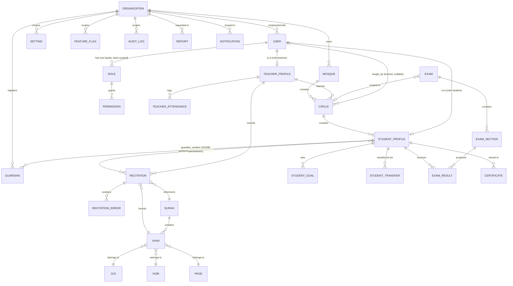

# وثيقة التحقق المعماري (Architecture Validation Document)
## منصة إدارة حلقات تحفيظ القرآن الكريم — SaaS متعددة المستأجرين

**الإصدار:** 1.0 (مسودة للمراجعة والموافقة)
**الحزمة التقنية:** Laravel 12 · Vue.js 3 + TypeScript · Inertia.js · Tailwind CSS · PostgreSQL 16+ · Redis

> **ملاحظة هامة:** هذه وثيقة تصميم معماري فقط. لا تحتوي على أي كود تنفيذي (لا migrations، لا models، لا controllers). الهدف منها هو المراجعة والموافقة على القرارات المعمارية قبل بدء أي تنفيذ.

---

## جدول المحتويات

1. [نموذج المجال (Domain Model)](#1-نموذج-المجال-domain-model)
2. [حدود الأمان (Security Boundaries)](#2-حدود-الأمان-security-boundaries)
3. [مصفوفة الصلاحيات (Authorization Matrix)](#3-مصفوفة-الصلاحيات-authorization-matrix)
4. [نموذج التهديدات (Threat Model)](#4-نموذج-التهديدات-threat-model)
5. [دورة حياة البيانات (Data Lifecycle)](#5-دورة-حياة-البيانات-data-lifecycle)
6. [تصميم Spatie Permission مع Teams](#6-تصميم-spatie-permission-مع-teams)
7. [الفرق بين Settings و Feature Flags](#7-الفرق-بين-settings-و-feature-flags)

---

## 1. نموذج المجال (Domain Model)

المنصة مبنية على نموذج **Multi-Tenancy بمفتاح تمييز (Discriminator Column)**: كل جدول "مملوك للمستأجر" (tenant-owned) يحمل عمود `organization_id`، ويتم فرض العزل عبر **Global Eloquent Scope** إلزامي على مستوى كل Model، لا على مستوى الاستعلامات الفردية. الجداول العالمية (مثل مرجع القرآن) لا تحمل `organization_id` لأنها بيانات مرجعية مشتركة بين كل المستأجرين.

### 1.1 الكيانات الأساسية

#### Organizations (المنظمات / المستأجرون)
- **الدور:** جذر العزل (Tenant Root). كل منظمة تمثل جمعية/مؤسسة تحفيظ مستقلة.
- **الحقول الجوهرية:** `id`, `name`, `slug`, `status` (active/suspended/trial), `subscription_plan_id` (اختياري لمرحلة لاحقة), `settings_locale`, `timestamps`, `deleted_at`.
- **العلاقات:** `hasMany` على كل الكيانات tenant-owned (Users, Mosques, Circles, Students, Teachers, ...).
- **ملاحظة عزل:** هذا الكيان هو نفسه حد العزل — لا يحمل `organization_id` لأنه *هو* المنظمة.

#### Users (المستخدمون)
- **قرار معماري مهم:** لا يوجد عمود `role_id` على جدول `users`. الأدوار والصلاحيات تُدار **حصرياً عبر Spatie Laravel-Permission** (جدول `model_has_roles` مع بُعد team إضافي `organization_id`).
- **الحقول الجوهرية:** `id`, `organization_id` (nullable لأجل Super Admin فقط — انظر §6.4), `name`, `email`, `phone`, `password`, `locale`, `status`, `last_login_at`, `deleted_at`.
- **العلاقات:** `belongsTo(Organization)`, علاقات Spatie (`roles()`, `permissions()`)، `hasOne(StudentProfile)` أو `hasOne(TeacherProfile)` بحسب الدور الفعلي.
- **ملاحظة:** مستخدم واحد قد يحمل أكثر من دور (مثال: معلم هو أيضاً ولي أمر) — هذا ممكّن طبيعياً لأن الأدوار عبر pivot لا عبر عمود واحد.

#### Roles (الأدوار) — عبر Spatie
- **الأدوار الستة:** `super-admin`, `org-admin`, `supervisor`, `teacher`, `student`, `parent`.
- **جدول Spatie:** `roles` (مع عمود `organization_id` كـ team key — nullable لـ super-admin العابر للمنظمات).
- لا جدول `roles` مخصص يُبنى يدوياً؛ الاعتماد الكامل على بنية Spatie القياسية مع تفعيل خاصية Teams.

#### Permissions (الصلاحيات) — عبر Spatie
- **دقة الصلاحيات:** كل صلاحية تمثل فعلاً محدداً على مورد محدد، مثل: `users.view`, `users.create`, `users.update`, `users.delete`, `circles.manage`, `circles.view`, `recitations.create`, `recitations.view`, `recitations.update`, `exams.approve`, `certificates.generate`, `reports.generate`, `settings.manage`, `feature-flags.manage`.
- **مبدأ التسمية:** `{resource}.{action}` لضمان قابلية التدقيق والفهرسة.
- **جدول Spatie:** `permissions` + `role_has_permissions` + `model_has_permissions` (لصلاحيات مباشرة على مستخدم دون دور، عند الحاجة).

#### Mosques / Centers (المساجد/المراكز)
- **تتبع لـ:** Organization (عبر `organization_id`).
- **الحقول الجوهرية:** `id`, `organization_id`, `name`, `address`, `city`, `phone`, `status`, `deleted_at`.
- **العلاقات:** `belongsTo(Organization)`, `hasMany(Circle)`.

#### Circles (الحلقات)
- **تتبع لـ:** Mosque (وبالتبعية Organization).
- **الحقول الجوهرية:** `id`, `organization_id`, `mosque_id`, `teacher_id` (**nullable** — حلقة قد تكون بلا معلم معيّن مؤقتاً), `name`, `level`, `capacity`, `status`, `deleted_at`.
- **العلاقات:** `belongsTo(Mosque)`, `belongsTo(Teacher)` (nullable), `hasMany(StudentProfile)`.

#### Teachers (المعلمون)
- **قرار معماري:** لا جدول `teachers` منفصل بالضرورة؛ "المعلم" هو `User` يحمل دور `teacher` عبر Spatie. إن احتاج النظام حقولاً مهنية إضافية (تخصص، إجازة سند، تاريخ تعيين) فتُخزّن في جدول ملحق `teacher_profiles` (`user_id`, `organization_id`, `specialization`, `ijazah_details`, `hired_at`).
- **العلاقات:** `belongsTo(User)`, `hasMany(Circle)` (الحلقات التي يُدرّسها), `hasMany(TeacherAttendance)`.

#### Students (الطلاب) — `student_profiles`
- **قرار معماري:** بالمثل، "الطالب" هو `User` بدور `student`، مع جدول ملحق `student_profiles` يحمل البيانات الدومينية.
- **الحقول الجوهرية:** `id`, `user_id`, `organization_id`, `mosque_id`, `circle_id` (nullable إذا لم يُخصَّص لحلقة بعد), `enrollment_number`, `birth_date`, `current_juz`, `status` (active/transferred/graduated/withdrawn), `deleted_at`.
- **العلاقات:** `belongsTo(User)`, `belongsTo(Mosque)`, `belongsTo(Circle)`, `hasMany(Recitation)`, `hasMany(StudentGoal)`, `hasMany(ExamResult)`, `hasMany(StudentTransfer)`, `belongsToMany(Guardian)` عبر `guardian_student`.

#### Guardians (أولياء الأمور)
- **قرار معماري مهم:** جدول `guardians` مستقل (ليس مجرد حقل هاتف على الطالب)، لأن ولي الأمر قد يكون مستخدماً له حساب دخول (`user_id` nullable — قد يُسجَّل لاحقاً)، وقد يكون ولياً لأكثر من طالب، وطالب قد له أكثر من ولي أمر (أب + أم مثلاً).
- **الحقول الجوهرية:** `id`, `organization_id`, `user_id` (nullable), `name`, `phone`, `email`, `relationship_type` (أب/أم/وصي), `deleted_at`.
- **جدول Pivot: `guardian_student`:**
  - `guardian_id`, `student_id`, `organization_id`,
  - **`permissions` (JSONB)** — تحديد دقيق لما يُسمح لهذا الولي رؤيته/فعله لهذا الطالب بعينه، مثل: `{"view_recitations": true, "view_exam_results": true, "view_attendance": false, "receive_notifications": true}`.
  - هذا التصميم يسمح بولي أمر له صلاحيات مختلفة تجاه كل ابن (مثال: صلاحيات موسّعة لابن، محدودة لابن آخر إن كان وصياً جزئياً).

#### Quran Reference (المرجع القرآني) — عالمي
- **قرار معماري:** الجداول `surahs`, `ayahs`, `juz`, `hizb`, `pages` **لا تحمل `organization_id`** — هي بيانات مرجعية عالمية ثابتة (نفس القرآن لكل المنظمات)، تُحمّل مرة واحدة (seed) وتُقرأ فقط (read-only) من كل المستأجرين.
- **العلاقات:** `Surah hasMany Ayah`, `Ayah belongsTo Juz/Hizb/Page` (علاقات مرجعية بنائية، ليست tenant-scoped).
- **الاستخدام:** الكيانات التطبيقية (Recitation, StudentGoal, ExamSection) تُشير إلى هذه الجداول عبر مفاتيح خارجية (`surah_id`, `from_ayah_id`, `to_ayah_id`) دون كسر العزل، لأن المرجع نفسه بلا هوية مستأجر.

#### Recitations (التسميع)
- **الحقول الجوهرية:** `id`, `organization_id`, `student_id`, `teacher_id`, `circle_id`, `surah_id`, `from_ayah_id`, `to_ayah_id`, `recitation_type` (حفظ جديد/مراجعة/تثبيت), `grade`/`score`, `notes`, **`idempotency_key` (unique)**, `recited_at`, `created_at`.
- **`idempotency_key`:** مفتاح فريد (عادة UUID يُولّده تطبيق العميل وقت الإدخال، خصوصاً في سياق **العمل دون اتصال Offline-first**) يمنع تكرار إدخال نفس عملية التسميع عند إعادة المزامنة (انظر §4 — Duplicate Offline Sync).
- **العلاقات:** `belongsTo(Student)`, `belongsTo(Teacher)`, `belongsTo(Circle)`, `hasMany(RecitationError)`.

#### Recitation Errors (أخطاء التسميع)
- **قرار معماري:** جدول منفصل `recitation_errors` وليس عموداً JSON على `recitations`، لأن تسميعاً واحداً قد يحوي عدة أخطاء من أنواع مختلفة، ويحتاج كل خطأ لموضع محدد (آية/كلمة) وتصنيف مستقل قابل للفهرسة والتحليل الإحصائي.
- **الحقول الجوهرية:** `id`, `recitation_id`, `organization_id`, `ayah_id`, `error_type` (تجويد/حفظ/نسيان/تكرار...), `severity`, `notes`.
- **العلاقات:** `belongsTo(Recitation)`.

#### Teacher Attendances (حضور المعلمين)
- **قرار معماري:** نموذج **قائم على النشاط (Activity-Based)** لا على الموقع الجغرافي (لا GPS) — يُستدل على الحضور من كون المعلم سجّل تسميعاً/نشاطاً فعلياً خلال نافذة الجلسة، أو عبر تسجيل حضور يدوي بواسطة المشرف (Supervisor) دون التحقق من الموقع.
- **الحقول الجوهرية:** `id`, `organization_id`, `teacher_id`, `circle_id`, `session_date`, `status` (present/absent/late/excused), `verified_by` (Supervisor user_id، nullable), `source` (auto-derived/manual), `notes`.

#### Student Transfers (نقل الطلاب)
- **الحقول الجوهرية:** `id`, `organization_id`, `student_id`, `from_mosque_id`, `to_mosque_id`, `from_circle_id`, `to_circle_id`, `reason`, `requested_by`, `approved_by` (nullable), `status` (pending/approved/rejected), **`metadata` (JSONB)** لأسباب إضافية/سياق مرن (مثال: مستندات مرفقة، ملاحظات المشرف السابق), `created_at`.
- **مبدأ Audit:** كل نقل يُنشئ سجلاً في `audit_logs` بالتوازي؛ **سجل النقل نفسه لا يُحذف ولا يُعدَّل بعد اعتماده** (انظر §5).

#### Student Goals (أهداف الطلاب)
- **الحقول الجوهرية:** `id`, `organization_id`, `student_id`, `period_type` (daily/weekly/monthly), `target_type` (حفظ/مراجعة), `surah_id`/`juz_id` (هدف مرجعي), `target_amount`, `achieved_amount`, `period_start`, `period_end`, `status`.

#### Exams (الامتحانات) + Exam Sections + Exam Results
- **Exams:** `id`, `organization_id`, `mosque_id`/`circle_id` (نطاق الامتحان), `title`, `exam_type`, `scheduled_at`, `status` (draft/scheduled/completed/approved).
- **Exam Sections:** `id`, `exam_id`, `organization_id`, `surah_id`/`from_ayah_id`/`to_ayah_id`, `section_type` (تلاوة/تجويد/تفسير), `max_score`.
- **Exam Results:** `id`, `exam_id`, `exam_section_id`, `student_id`, `organization_id`, `score`, `grade`, `examiner_id`, `status` (draft/submitted/**approved**), `approved_by`, `approved_at`.
- **قرار معماري جوهري: الثبات بعد الاعتماد (Immutability After Approval)** — بعد أن يصبح `status = approved`، لا يجوز تعديل `score`/`grade` مباشرة؛ أي تصحيح لاحق يجب أن يمر عبر **Correction Workflow** مخصص (سجل تصحيح جديد يشير إلى النتيجة الأصلية + سبب + من اعتمد التصحيح) مع Audit Log كامل. هذا يحمي مصداقية السجل الأكاديمي.

#### Certificates (الشهادات)
- **الحقول الجوهرية:** `id` (**ULID** لا Auto-Increment — لصعوبة التخمين والتحقق العلني اللاحق), `organization_id`, `student_id`, `exam_id`/`certificate_type`, `issued_at`, `issued_by`, `verification_code` (مستقل عن ULID، للتحقق العلني), `file_path` (**Private Storage**), `status` (issued/revoked).
- **Feature-Flagged:** توليد الشهادات مرهون بعلم ميزة `certificates.enabled` على مستوى المنظمة (انظر §7) — منظمة قد لا تُفعّل هذه الميزة إطلاقاً.
- **قرار أمان:** ملف الشهادة يُخزَّن في **Private Disk** (غير قابل للوصول المباشر عبر URL عام)؛ الوصول فقط عبر Route محمي بصلاحية + توقيع مؤقت (Signed URL قصير الأجل) عند الحاجة للتنزيل.

#### Reports (التقارير)
- **الحقول الجوهرية:** `id`, `organization_id`, `requested_by`, `report_type`, `parameters` (JSONB), `status` (queued/processing/completed/failed), `file_path` (**Private Storage**), `expires_at`.
- **قرار معماري:** التوليد يتم عبر **Queue Job** غير متزامن (لأن التقارير قد تكون ثقيلة: تجميع تسميع/حضور/نتائج عبر فترات طويلة) — لا يُنتظر توليدها في نفس الطلب HTTP.

#### Settings (الإعدادات)
- **نموذج Key-Value:** `id`, `organization_id` (nullable للإعدادات العالمية الافتراضية), `key`, `value`, `type` (string/int/bool/json).
- **الاستخدام النموذجي:** مصطلحات قابلة للتخصيص لكل منظمة (مثال: تسمية "الحلقة" قد تكون "الفرقة" في منظمة أخرى)، عتبات (نسبة النجاح في الامتحان)، تفضيلات عرض.
- **Cache:** تُخزَّن في Redis بمفتاح يضم `organization_id` (انظر §7).

#### Feature Flags (أعلام الميزات)
- **جدول منفصل تماماً عن Settings:** `id`, `organization_id` (nullable = افتراضي عالمي قابل للتجاوز على مستوى منظمة), `flag_key`, `enabled` (boolean فقط), `updated_by`.
- الفرق التفصيلي مع Settings في §7.

#### Audit Logs (سجلات التدقيق)
- **الحقول الجوهرية:** `id`, `organization_id`, `user_id` (الفاعل), `action`, `auditable_type`, `auditable_id`, **`old_values` (JSONB)**, **`new_values` (JSONB)**, `ip_address`, `user_agent`, **`request_id`** (لربط كل التغييرات الناتجة عن طلب HTTP واحد ببعضها — تتبّع Traceability كامل), `created_at`.
- **قرار معماري:** جدول `audit_logs` نفسه **Append-Only** — لا Update ولا Delete عليه إطلاقاً (حتى من Super Admin عبر التطبيق؛ فقط عبر سياسة احتفاظ/أرشفة منضبطة على مستوى قاعدة البيانات).

#### Notifications (الإشعارات)
- **الحقول الجوهرية:** يُستخدم نظام Laravel Notifications القياسي (`notifications` table: `id` (UUID), `type`, `notifiable_type`, `notifiable_id`, `data` (JSON), `read_at`) مع تعديل يضيف `organization_id` لتمكين العزل حتى في هذا الجدول.
- **Queued:** كل الإشعارات (بريد/SMS/داخل التطبيق) تُرسل عبر Queue لا بشكل متزامن.
- **قابلة للتوسّع:** تصميم يسمح بإضافة قنوات جديدة (Push, WhatsApp) دون تغيير هيكلي.

### 1.2 مخطط العلاقات (ER Diagram) — صيغة نصية

**ملاحظة على المخطط:** `SURAH`, `AYAH`, `JUZ`, `HIZB`, `PAGE` هي الجداول العالمية الوحيدة بلا `organization_id` — تظهر في المخطط كمرجع مشترك تشير إليه الكيانات التطبيقية دون أن تنتمي لأي مستأجر.

---

## 2. حدود الأمان (Security Boundaries)

كل حد أمني أدناه يُطبَّق على **طبقتين متكاملتين**: طبقة الاستعلام (Query Layer — Global Scope) وطبقة التفويض (Authorization Layer — Policies/Gates). لا يجوز الاعتماد على طبقة واحدة فقط.

| الحد | يبدأ عند | ينتهي عند | آلية التطبيق |
|---|---|---|---|
| **حدود المستأجر (Tenant Boundary)** | أي استعلام على جدول يحمل `organization_id` | حدود المنظمة الحالية للمستخدم المصادَق عليه (من الجلسة/Token) | **Global Eloquent Scope إلزامي** على كل Model tenant-owned، يُطبَّق تلقائياً دون حاجة لتذكّر المطوّر إضافته في كل استعلام. لا استثناءات إلا عبر Context صريح (Super Admin Impersonation المُدقَّق). |
| **حدود مدير المنظمة (Org Admin)** | داخل حدود المستأجر أعلاه | لا يتجاوز منظمته أبداً — لا رؤية عابرة للمنظمات | Policy تتحقق أن `$user->organization_id === $resource->organization_id` بالإضافة إلى صلاحية Spatie المناسبة (team-scoped تلقائياً). |
| **حدود المسجد (Mosque)** | معلم/مشرف مرتبط بمسجد واحد أو أكثر ضمن منظمته | لا يرى مساجد أخرى لم يُخصَّص لها، حتى داخل نفس المنظمة | جدول ربط (`teacher_mosque` أو استنتاج من `circle.mosque_id` التي يُدرّسها) + Policy تفحص العضوية قبل عرض بيانات المسجد. |
| **حدود الحلقة (Circle)** | معلم مرتبط بحلقة واحدة أو أكثر (`circle.teacher_id`) | لا يسجّل تسميعاً أو يرى بيانات طالب في حلقة لا يُدرّسها | Policy على `Recitation::create` تتحقق أن `$student->circle_id` ضمن الحلقات المخصصة لـ `$teacher`. |
| **حدود المعلم (Teacher)** | بيانات المعلم نفسه (حضوره، حلقاته) | لا يرى سجلات حضور/تقييم معلمين آخرين | Policy تقارن `$teacher->id === $resource->teacher_id`، ولا صلاحية `users.view` عامة على مستوى المعلم. |
| **حدود الطالب (Student)** | حساب الطالب نفسه | لا يرى بيانات طالب آخر بأي حال | Policy صارمة: `$user->id === $resource->student_profile->user_id` فقط؛ لا استثناء. |
| **حدود ولي الأمر (Parent/Guardian)** | الأبناء المصرَّح بهم فقط، وبحسب `permissions` JSONB في `guardian_student` | لا يرى ابناً غير مرتبط به، ولا يتجاوز الصلاحية المحددة له لكل ابن (مثال: قد يرى النتائج لكن لا الحضور) | Policy تتحقق أولاً من وجود صف في `guardian_student` يربط `guardian` بـ`student`، ثم تفحص مفتاح الصلاحية المحدد داخل JSONB (مثل `permissions->view_exam_results`) قبل السماح بكل نوع بيانات على حدة. |

**مبدأ التركيب (Composability):** الحدود أعلاه **متداخلة لا متوازية** — كل حد أضيق محتوى داخل الحد الأوسع منه (Student ⊂ Circle ⊂ Mosque ⊂ Organization ⊂ Tenant Boundary). كسر أي حد أوسع (مثل Global Scope) يُبطل كل الحدود الداخلية تلقائياً، لذا **حدود المستأجر هي خط الدفاع الأول والأهم** ويجب أن تكون غير قابلة للتجاوز عن طريق الخطأ (fail-closed لا fail-open).

---

## 3. مصفوفة الصلاحيات (Authorization Matrix)

النطاق الفعلي لكل صلاحية محكوم بحدود القسم 2 أعلاه (مثال: "Read" لمعلم يعني "طلاب حلقته فقط" لا "كل الطلاب"). الجدول التالي يوضح **وجود الصلاحية من حيث المبدأ**؛ النطاق التفصيلي مذكور بين قوسين.

| الإجراء | Super Admin | Org Admin | Supervisor | Teacher | Student | Parent |
|---|---|---|---|---|---|---|
| **Create** (طلاب/معلمين/حلقات) | ✅ (كل المنظمات) | ✅ (منظمته) | ✅ محدود (ضمن مساجده) | ❌ | ❌ | ❌ |
| **Read** | ✅ (كل المنظمات) | ✅ (منظمته) | ✅ (مساجده) | ✅ (حلقته/طلابه) | ✅ (نفسه فقط) | ✅ (أبناؤه المصرَّح بهم) |
| **Update** | ✅ | ✅ (منظمته) | ✅ محدود (مساجده) | ✅ محدود (تسميع طلابه فقط) | ❌ | ❌ |
| **Delete** (Soft) | ✅ | ✅ (منظمته) | ❌ (يطلب فقط) | ❌ | ❌ | ❌ |
| **Export** (بيانات/تقارير) | ✅ | ✅ (منظمته) | ✅ محدود (مساجده) | ❌ | ❌ | ❌ |
| **Transfer** (نقل طالب) | ✅ | ✅ (اعتماد + طلب) | ✅ (طلب فقط، يحتاج اعتماد Org Admin) | ❌ | ❌ | ❌ |
| **Approve** (نتائج امتحان/نقل) | ✅ | ✅ (منظمته) | ✅ محدود (نتائج مساجده، قابل للتقييد سياسياً) | ❌ | ❌ | ❌ |
| **Generate Certificates** | ✅ | ✅ (إذا Feature Flag مفعّل) | ❌ | ❌ | ❌ | ❌ |
| **Generate Reports** | ✅ (كل المنظمات) | ✅ (منظمته) | ✅ محدود (مساجده) | ✅ محدود جداً (تقرير حلقته فقط، إن مُنح) | ❌ | ❌ |
| **Manage Users** (إنشاء/تعديل/تعطيل حسابات) | ✅ | ✅ (منظمته) | ❌ | ❌ | ❌ | ❌ |
| **Manage Permissions** (تعيين أدوار) | ✅ (أي دور بما فيه Org Admin) | ✅ (أدوار أقل من Org Admin داخل منظمته) | ❌ | ❌ | ❌ | ❌ |
| **Manage Terminology** (Settings) | ✅ (الافتراضي العالمي) | ✅ (منظمته) | ❌ | ❌ (قراءة فقط) | ❌ | ❌ |
| **Manage Feature Flags** | ✅ (عالمياً + تجاوز أي منظمة) | ✅ محدود (فقط الأعلام المسموح للمنظمة تفعيلها/تعطيلها ذاتياً) | ❌ | ❌ | ❌ | ❌ |

**ملاحظات على المصفوفة:**
- ✅ محدود = الصلاحية موجودة لكن نطاقها مقيَّد بحد أمني من القسم 2 (وليست صلاحية جزئية في Spatie نفسه — التقييد يتم في Policy).
- Super Admin هو الدور الوحيد **العابر للمنظمات (Cross-Tenant by design)** — انظر §6.4 لشرح كيف يُصمَّم هذا دون كسر Global Scope.
- "Manage Feature Flags" لـ Org Admin مقصورة على الأعلام المصنّفة كـ *self-service* (مثل تفعيل/تعطيل ميزة الشهادات لمنظمته)، وليس أعلام النظام الجوهرية (مثل تفعيل Multi-Tenancy نفسه) التي تبقى حصراً لـ Super Admin.

---

## 4. نموذج التهديدات (Threat Model)

| # | التهديد | السياق في هذا النظام | آلية الدفاع |
|---|---|---|---|
| 1 | **IDOR** | تخمين `recitation_id` أو `student_id` في URL للوصول لبيانات طالب آخر | Route Model Binding + **Policy `authorize()` على كل موديل** تتحقق من `organization_id` والحدود الأضيق (circle/mosque) قبل أي إرجاع بيانات؛ عدم الاعتماد على "الإخفاء عبر الغموض" (Security through Obscurity) في المعرّفات. |
| 2 | **Broken Access Control** | نقطة API تُرجع بيانات دون فحص الدور/النطاق بشكل متسق | Policy لكل Model + Middleware مركزي يفرض `organization_id` عبر Global Scope + مراجعة كل Controller Action لاستخدام `authorize()` قبل أي عملية (لا يوجد استثناء "أنا واثق أنها آمنة"). |
| 3 | **Privilege Escalation** | مستخدم يعدّل حمولة الطلب لتعيين نفسه دوراً أعلى، أو معلم يحاول تعديل `organization_id` في طلب Update | **Mass Assignment Protection** (`$fillable` دقيق، استثناء `role`/`organization_id`/`permissions` من أي إدخال مباشر من العميل) + تعيين الأدوار حصراً عبر Endpoint محمي بصلاحية `Manage Permissions` مع تحقق أن المانح لا يمنح دوراً أعلى من دوره. |
| 4 | **SQL Injection** | إدخال بيانات مستخدم في استعلامات ديناميكية (فلترة تقارير، بحث) | الاعتماد الكامل على **Eloquent Query Builder / Parameter Binding**؛ منع أي بناء استعلام بـ Raw String concatenation؛ مراجعة كودية لأي استخدام لـ `DB::raw` للتأكد من عدم تمرير مدخلات خام. |
| 5 | **XSS** | حقن سكربت في حقول نصية (ملاحظات تسميع، أسماء) تُعرض لاحقاً في تقرير/شاشة | Vue 3 يُعقِّم المخرجات تلقائياً عبر `{{ }}` (لا `v-html` لبيانات مستخدم)؛ فرض **CSP Headers**؛ تعقيم/تحقق المدخلات على الخادم (Validation Rules) قبل التخزين. |
| 6 | **CSRF** | طلب مزوَّر من موقع خارجي يستخدم جلسة المستخدم النشطة | Laravel CSRF Token المدمج (`VerifyCsrfToken` middleware) مفعّل لكل الطلبات State-Changing عبر Inertia؛ `SameSite=Lax/Strict` على الكوكيز. |
| 7 | **Session Hijacking** | سرقة جلسة معلم/مدير عبر شبكة غير آمنة أو XSS | **HTTPS إلزامي** (HSTS)، كوكيز `HttpOnly` + `Secure` + `SameSite`، تدوير Session ID عند تسجيل الدخول، إبطال الجلسات القديمة عند تغيير كلمة المرور. |
| 8 | **Brute Force + Credential Stuffing** | محاولات تخمين كلمات مرور متكررة على تسجيل الدخول | **Rate Limiting** على مستوى IP وعلى مستوى الحساب (Laravel Throttle)، قفل مؤقت بعد عدد محاولات فاشلة، دعم اختياري لـ 2FA للأدوار الحساسة (Org Admin/Super Admin). |
| 9 | **Mass Assignment** | إرسال حقول إضافية في طلب Update (مثل `organization_id` أو `is_approved`) لم تُصمَّم لتُعدَّل من العميل | `$fillable` صريح ومحدود على كل Model (لا `$guarded = []`)؛ **Form Requests** مع قواعد تحقق (`validated()`) بدل تمرير `$request->all()` مباشرة لأي `update()`/`create()`. |
| 10 | **File Upload Abuse + Path Traversal** | رفع ملف تنفيذي متنكر كصورة، أو اسم ملف يحتوي `../` للكتابة خارج مجلد التخزين | التحقق من **MIME Type الحقيقي** (لا الامتداد فقط)، إعادة تسمية الملفات بمعرّفات مولَّدة (UUID/ULID) لا بالاسم الأصلي، تخزين خارج `public/` قدر الإمكان، فحص حجم/نوع صارم عبر Validation Rules، تعطيل تنفيذ السكربتات في مجلد التخزين. |
| 11 | **Report/Certificate Data Leakage** | رابط تقرير/شهادة يُخزَّن أو يُشارك ويبقى صالحاً للأبد أو يمكن الوصول له بدون تفويض | **Private Disk إلزامي** لكل التقارير والشهادات (لا `public` disk)، الوصول فقط عبر Route محمي بـ Policy + **Signed URLs مؤقتة الصلاحية** عند الحاجة لتنزيل مباشر، `expires_at` على التقارير مع تنظيف دوري. |
| 12 | **Cross-Tenant Data Leakage** | استعلام ينسى فلترة `organization_id` فيُظهر بيانات منظمة أخرى (الخطر الأكبر في نظام Multi-Tenant) | **Global Scope إلزامي غير قابل للتجاوز بالخطأ** على كل Model tenant-owned، تُطبَّق آلياً عبر Trait/Boot method لا عبر تذكّر يدوي؛ اختبارات آلية (Feature Tests) تتحقق تحديداً من عزل كل Endpoint بين منظمتين وهميتين؛ **Cache Keys تضم `organization_id`** دائماً (انظر §6.3) لمنع تسرّب عبر Redis. |
| 13 | **Replay Attacks** | إعادة إرسال نفس طلب حساس (مثل اعتماد نتيجة امتحان) عدة مرات لإحداث تأثير مكرر | استخدام **`idempotency_key`** على العمليات الحساسة القابلة للتكرار (Recitations، وقابل للتوسعة على أي Endpoint حساس)، فحص Unique Constraint على مستوى قاعدة البيانات لا فقط منطق التطبيق. |
| 14 | **Duplicate Offline Sync** | تطبيق المعلم يعمل دون اتصال، يسجّل تسميعاً محلياً، ثم يُعيد المزامنة عند استعادة الاتصال فيُدخل نفس السجل مرتين | **`idempotency_key` (UUID يُولَّد على العميل وقت الإدخال الفعلي، لا وقت المزامنة)** + Unique Constraint في قاعدة البيانات + الخادم يتعامل مع تكرار المفتاح كـ "نجاح صامت" (Idempotent Response) لا كخطأ يعطّل المزامنة. |
| 15 | **Race Conditions** (نقل متزامن، حضور متزامن) | مشرفان يعتمدان نقل نفس الطالب لحلقتين مختلفتين في نفس اللحظة، أو تسجيل حضور مزدوج | **Database-Level Locking** (`SELECT ... FOR UPDATE` أو Optimistic Locking بعمود `version`) عند تنفيذ عمليات الاعتماد الحساسة داخل Transaction، Unique Constraints تمنع حالات تضارب معروفة (مثال: سجل حضور واحد فقط لكل `teacher_id + circle_id + session_date`). |
| 16 | **Enumeration Attacks** (التحقق من الشهادات، تعداد المستخدمين) | تجربة أكواد تحقق شهادات متتالية، أو تجربة بريد إلكتروني تلو الآخر لمعرفة أيّها مسجَّل | **ULID/كود تحقق عشوائي طويل غير متسلسل** للشهادات (لا Auto-Increment قابل للتخمين)، رسائل خطأ عامة موحَّدة لا تكشف "البريد غير موجود" مقابل "كلمة المرور خاطئة"، Rate Limiting على صفحة التحقق العلني من الشهادات. |
| 17 | **Malicious Teacher/Parent Requests** | معلم يحاول تسجيل تسميع لطالب ليس في حلقته عبر تعديل معرّف الطالب في الطلب، أو ولي أمر يحاول الوصول لبيانات ابن غير مصرَّح به | Policy تفرض التحقق من العضوية (Circle Membership / Guardian-Student Link) **على كل طلب**، لا الاعتماد على أن واجهة المستخدم "لا تعرض" الخيار الخاطئ — الفرض يكون على مستوى الخادم دوماً بصرف النظر عن سلوك الواجهة. |

---

## 5. دورة حياة البيانات (Data Lifecycle)

| عائلة الكيانات | الإنشاء | التعديل | الحذف الناعم | الأرشفة | الثبات التاريخي | الحذف الدائم | فترة الاحتفاظ |
|---|---|---|---|---|---|---|---|
| **Users / Students / Teachers / Guardians** | عبر Org Admin/Supervisor مع Validation صارم | مسموح لحقول الملف الشخصي؛ الحقول الحساسة (organization_id, role) عبر Endpoint مقيَّد فقط | ✅ (`deleted_at`) — الحساب يُعطَّل ولا يُحذف فعلياً | بعد فترة تعطيل طويلة (مثال: سنتان) يُنقل لأرشيف قراءة فقط | لا ينطبق مباشرة (الكيان نفسه قابل للتعديل قبل الحذف) | ⚠️ **غير مسموح إن وُجدت سجلات تسميع/نتائج مرتبطة (RESTRICT)** — انظر الملاحظة أدناه | حسب سياسة الامتثال المحلية (تُحدَّد لاحقاً)، لا تقل عن فترة الاحتفاظ القانونية للسجلات التعليمية |
| **Mosques / Circles** | عبر Org Admin | مسموح (تغيير معلم الحلقة، السعة...) | ✅ (`deleted_at`) | عند إغلاق مسجد/حلقة نشاطياً | لا ينطبق | ⚠️ **RESTRICT إذا وُجد طالب/تسميع مرتبط تاريخياً** | مرتبطة بعمر المنظمة نفسها |
| **Recitations + Recitation Errors** | عبر Teacher فقط، وقت التسميع الفعلي | ✅ محدود جداً (تصحيح خطأ إدخال قريب زمنياً، بسياسة نافذة زمنية قصيرة + Audit) | ❌ **لا يُحذف حتى ناعماً بعد انتهاء نافذة التصحيح** — السجل التاريخي للتسميع مقدَّس | لا أرشفة نشطة — يبقى قابلاً للاستعلام دائماً لأغراض تتبّع تقدّم الطالب | ✅ **ثبات كامل** بعد نافذة التصحيح — هذا هو السجل الأكاديمي الأساسي للطالب | ❌ **ممنوع نهائياً عبر التطبيق** | دائم (طوال عمر علاقة الطالب بالمنظمة، وبعدها للأرشيف التاريخي) |
| **Exams + Exam Sections + Exam Results** | عبر Teacher/Supervisor (Draft) | ✅ حتى `status = submitted` | ❌ لا حذف بعد `approved` | نتائج الدورات القديمة تُؤرشف للقراءة فقط بعد إغلاق الفصل/الدورة | ✅ **ثبات صارم بعد `approved`** — أي تصحيح إجباري عبر **Correction Workflow** منفصل (سجل تصحيح جديد + سبب + معتمِد + Audit Log كامل)، لا تعديل مباشر على الحقل الأصلي | ❌ ممنوع | دائم للسجل الأكاديمي المعتمد |
| **Certificates** | عبر Org Admin (إن كان Feature Flag مفعّلاً)، بعد اعتماد النتيجة المرتبطة | ❌ لا تعديل محتوى الشهادة بعد الإصدار | ✅ حالة `revoked` (بدلاً من حذف) مع سبب وتاريخ | الشهادات المُلغاة تبقى قابلة للاستعلام (للتحقق من "كانت موجودة ثم أُلغيت") | ✅ سجل الإصدار الأصلي لا يُمحى أبداً، حتى بعد الإلغاء | ❌ ممنوع (فقط تغيير الحالة إلى `revoked`) | دائم |
| **Reports** | عبر Queue Job بطلب مستخدم مخوَّل | لا ينطبق (الملف نهائي بعد التوليد) | ✅ | لا أرشفة — تُحذف الملفات الفعلية بعد `expires_at` | لا ينطبق (تقرير لحظي وليس سجلاً تاريخياً بذاته) | ✅ حذف فعلي للملف من التخزين بعد انتهاء الصلاحية (تنظيف دوري) | قصيرة الأجل (أيام إلى أسابيع بحسب سياسة المنظمة) |
| **Student Transfers** | عبر Supervisor (طلب) → Org Admin (اعتماد) | ❌ لا تعديل على سجل نقل معتمد | ❌ | تبقى في السجل التاريخي للطالب دائماً | ✅ **السجل التاريخي للنقل لا يتغير أبداً** — النقل يُنشئ سجلاً جديداً، لا يُعدّل سجلات `circle_id` القديمة على مستوى التسميع التاريخي (أي تسميع سابق يبقى مرتبطاً بالحلقة التي حدث فيها فعلياً وقتها) | ❌ ممنوع | دائم |
| **Audit Logs** | تلقائي عند أي عملية حساسة | ❌ Append-Only صراحة | ❌ (لا معنى لحذف ناعم على سجل تدقيق) | تُنقل للأرشيف البارد (Cold Storage) بعد فترة طويلة (لتخفيف حجم الجدول الفعّال) | ✅ **ثبات كامل مطلق** — هذا الجدول *هو* آلية الثبات لبقية النظام | ⚠️ فقط عبر سياسة احتفاظ قانونية منضبطة على مستوى قاعدة البيانات (خارج تحكم التطبيق العادي) | طويلة جداً، بحسب المتطلبات القانونية/التنظيمية |
| **Settings / Feature Flags** | عبر Org Admin/Super Admin | ✅ مباشر | ✅ (نادراً — إزالة إعداد قديم غير مستخدم) | لا ينطبق | لا ينطبق (قيم تشغيلية حالية لا سجل تاريخي) | ✅ ممكن عند إزالة ميزة قديمة نهائياً من النظام | مرتبطة بعمر الميزة/الإعداد في المنتج |

**توضيحات صريحة (كما طلب المستخدم):**

1. **حذف طالب/معلم/حلقة/مسجد لا يحذف سجلات التسميع مطلقاً.** يُطبَّق هذا عبر قيد `ON DELETE RESTRICT` (لا `CASCADE` ولا `SET NULL`) على المفاتيح الخارجية من `recitations`/`exam_results` نحو `student_profiles`/`teacher_profiles`/`circles`/`mosques`. إن حاول أحد حذف كيان أب له سجلات تسميع مرتبطة، يجب أن تفشل العملية (أو تتحول تلقائياً لحذف ناعم فقط) — لا يوجد مسار لحذف طالب "بكل بياناته" دفعة واحدة.

2. **نتائج الامتحانات المعتمدة لا تُعدَّل إلا عبر workflow تصحيح مع Audit Log كامل.** الحقل `status = approved` هو بوابة قفل (Lock Gate) — بعد تجاوزها، أي `UPDATE` مباشر على `score`/`grade` يجب أن يكون محظوراً على مستوى Policy/Application Logic؛ التصحيح الوحيد المسموح هو إنشاء **سجل تصحيح جديد** (Correction Record) يشير إلى النتيجة الأصلية، مع حفظ: من طلب التصحيح، من اعتمده، السبب، والقيمة القديمة/الجديدة — كل ذلك في `audit_logs` بالتوازي مع سجل تصحيح دومين مخصص إن لزم.

3. **النقل لا يغيّر السجلات التاريخية.** عند نقل طالب من حلقة (أ) إلى حلقة (ب)، كل سجلات التسميع/الحضور/النتائج السابقة تبقى مرتبطة بـ `circle_id` = (أ) كما حدثت فعلياً؛ فقط السجلات *المستقبلية* (بعد تاريخ النقل) تُنشأ بـ `circle_id` = (ب). سجل `student_transfers` نفسه هو المصدر الوحيد لمعرفة "متى ولماذا" تغيّر انتساب الطالب، دون إعادة كتابة أي تاريخ سابق.

---

## 6. تصميم Spatie Permission مع Teams

### 6.1 إعداد `config/permission.php` (وصفياً)

يُفعَّل خيار **Teams** في حزمة Spatie Laravel-Permission، مع تعيين:
- `teams => true`
- `team_foreign_key => 'organization_id'`

هذا يعني أن جداول Spatie الأساسية (`roles`, `permissions`, `model_has_roles`, `model_has_permissions`, `role_has_permissions`) تحصل تلقائياً على عمود إضافي `organization_id`، فيصبح **الدور نفسه معرَّفاً ضمن سياق منظمة محددة**، لا دوراً عاماً واحداً يُشارَك بين كل المستأجرين.

**الأثر العملي:** دور باسم `teacher` ليس صفاً واحداً في `roles` يُستخدم عبر كل المنظمات، بل قد يكون هناك صف `teacher` لكل منظمة (أو صف واحد مشترك بالاسم لكن الربط في `model_has_roles` يحمل `organization_id` الذي يحدد *أي* منظمة يخصّها هذا التخصيص). النتيجة: تعيين مستخدم كـ `teacher` في منظمة (أ) لا يمنحه أي شيء في منظمة (ب) إطلاقاً.

### 6.2 تحديد نطاق الأدوار والصلاحيات بالمنظمة

عند فحص "هل هذا المستخدم يملك دور/صلاحية معينة؟"، حزمة Spatie (بعد تفعيل Teams) تتحقق تلقائياً من **`organization_id` النشط حالياً** في سياق الطلب (يُحدَّد عادة عبر Middleware يستدعي `setPermissionsTeamId($user->organization_id)` عند بداية كل طلب مصادَق عليه). هذا يعني:
- كل فحص `$user->hasRole('teacher')` أو `$user->can('recitations.create')` يكون **ضمنياً مقيَّداً بمنظمة المستخدم الحالية** دون الحاجة لكتابة الشرط يدوياً في كل مكان.
- إن كان لمستخدم واحد أدوار في أكثر من منظمة (حالة نادرة، مثل مستشار خارجي)، يجب تبديل `team_id` بوضوح (`setPermissionsTeamId`) عند تبديل سياق العمل، ولا يجوز خلط النتائج بين السياقين في نفس الطلب.

### 6.3 بناء Cache Key مع `organization_id` لمنع التسرب

حزمة Spatie تُخزِّن خريطة الأدوار/الصلاحيات في **Redis Cache** لتقليل الاستعلامات المتكررة. الخطر الجوهري في بيئة Multi-Tenant: إن كان مفتاح الـ Cache لا يميّز بين المستأجرين (مثال: مفتاح عام `spatie.permission.cache`)، فإن أول منظمة تُحمِّل الكاش تُلوِّث النتائج لكل المنظمات اللاحقة التي تقرأ من نفس المفتاح خطأً.

**القرار المعماري:** يجب أن يضم مفتاح الكاش (Cache Key) بُعد `organization_id` بشكل صريح (سواء عبر آلية Spatie الداخلية عند تفعيل Teams التي تُدرج `team_id` ضمن سياق الكاش تلقائياً، أو عبر Cache Prefix مخصص يضاف على مستوى التطبيق إن استُخدمت طبقات Cache إضافية فوق Spatie لأي غرض تطبيقي آخر مثل Settings). **المبدأ العام لكل كاش في هذا النظام:** لا مفتاح كاش عالمي لأي بيانات tenant-scoped — دوماً `cache_key = "{prefix}:{organization_id}:{resource_key}"`.

### 6.4 الفرق بين Super Admin والأدوار العادية

- **الأدوار العادية (Org Admin, Supervisor, Teacher, Student, Parent):** كل تخصيص دور لها **مربوط بـ `organization_id` محدد** عبر آلية Teams أعلاه. مستخدم بدور `org-admin` في منظمة (أ) هو مستخدم عادي بلا أي صلاحية في منظمة (ب).
- **Super Admin:** دور **عابر للمنظمات (Global Role)** بالتصميم — يُمثَّل بتخصيص دور بلا `organization_id` مقيِّد (أو بآلية استثناء صريحة في طبقة التفويض: "إن كان `hasRole('super-admin')` بلا اعتبار لأي team context، تجاوز فحص Global Scope الخاص بـ organization_id"). هذا الاستثناء **الوحيد المسموح به** في كل النظام لتجاوز حدود المستأجر، ويجب أن يكون:
  - محدوداً لعدد قليل جداً من الحسابات (فريق تشغيل المنصة فقط).
  - مُسجَّلاً بالكامل في `audit_logs` عند أي عملية "تجاوز حد منظمة" (Impersonation/Cross-Tenant Access) — لا استثناء صامت.
  - غير قابل للتفويض من Org Admin لأي مستخدم آخر (Super Admin يُعيَّن فقط عبر عملية تشغيلية خارج تدفق التطبيق العادي، أو عبر Super Admin آخر بصلاحية `Manage Permissions` العابرة للمنظمات المذكورة في §3).

---

## 7. الفرق بين Settings و Feature Flags

قرار تصميمي جوهري في هذه المنصة هو **الفصل التام بين جدولين** يبدوان متشابهين ظاهرياً (كلاهما "قيم تُخصِّص سلوك النظام") لكنهما مختلفان جذرياً في الغرض والتحكم والمخاطر.

| البُعد | Settings (الإعدادات) | Feature Flags (أعلام الميزات) |
|---|---|---|
| **الغرض** | تخصيص **محتوى وسلوك تشغيلي** — مصطلحات (تسمية "الحلقة")، عتبات (نسبة نجاح الامتحان)، تفضيلات عرض (لغة، تنسيق تاريخ) | تشغيل/تعطيل **وظيفة كاملة** من النظام — هل ميزة الشهادات مفعّلة؟ هل التقارير المتقدمة متاحة؟ |
| **نوع القيمة** | متنوع (نص، رقم، JSON) | **Boolean فقط** — لا قيم أخرى، لا استثناء |
| **من يقرأ** | قد يقرأها **المعلم أو حتى الطالب** (مثال: معرفة تسمية "الحلقة" المحلية للمنظمة لعرضها في الواجهة) | فقط الطبقة التطبيقية (Backend Logic/Route Middleware) تقرأها لتقرر إظهار/إخفاء ميزة كاملة؛ المستخدم النهائي لا "يقرأ" العلم مباشرة، بل يرى أثره (وجود/غياب زر) |
| **من يكتب** | Org Admin (لمنظمته) أو Super Admin (الافتراضي العالمي) | **حصراً الإدارة** (Org Admin للأعلام self-service المحدودة، Super Admin للأعلام الجوهرية) — Supervisor/Teacher لا يكتبون أبداً |
| **التخزين المؤقت (Caching)** | تُخزَّن في Redis بمفتاح `settings:{organization_id}:{key}` لأنها تُقرأ بكثرة وتتغيّر نادراً؛ Invalidation فوري عند أي `update` | تُخزَّن أيضاً في Redis بمفتاح مستقل `feature-flags:{organization_id}:{flag_key}` — **مفتاح منفصل تماماً** عن Settings لأن دورة حياة القراءة مختلفة (الأعلام تُفحَص على كل طلب تقريباً كـ Guard، بينما Settings تُقرأ عند العرض) |
| **التحقق (Validation)** | تحقق بحسب `type` المُعلن (string/int/bool/json) — قواعد تحقق متنوعة | تحقق ثنائي بسيط (true/false) — لا حاجة لمنطق تحقق معقّد |
| **التخويل (Authorization)** | صلاحية `settings.manage` للكتابة، لا صلاحية مطلوبة للقراءة العامة (بيانات غير حساسة) | صلاحية `feature-flags.manage` للكتابة **فقط** — حتى القراءة المباشرة لقيمة العلم (لا أثره) قد تكون مقيَّدة، لأن كشف "أي ميزات مفعّلة داخلياً" قد يُستغل استكشافياً |
| **مثال ملموس** | `key = "circle_label"`, `value = "الفرقة"` | `flag_key = "certificates.enabled"`, `enabled = false` |
| **أثر الخطأ إن أُخطئ التصنيف** | إن عُومل كـ Feature Flag: فقدان المرونة في التخصيص النصي، حاجة لقيم Boolean مصطنعة | إن عُومل كـ Setting: خطر السماح لغير المخوَّلين (حتى للقراءة) باستكشاف/تعديل تشغيل ميزات حساسة (مثل تفعيل الشهادات دون رقابة مالية/إدارية) |

**السبب الجذري للفصل:** Feature Flags تتحكم في **سطح الهجوم الوظيفي (Functional Attack Surface)** للنظام — تفعيل ميزة خاطئ قد يفتح مساراً كاملاً لم يُختبر أمنياً بعد لمنظمة معينة. لذا معاملتها كجدول أمني منفصل بضوابط كتابة أشد من Settings العادية ليست تفصيلاً تقنياً، بل **قرار أمان معماري مقصود**.

---

## ملخص الحالة

هذه الوثيقة تُغطّي السبعة أقسام المطلوبة بالكامل: نموذج المجال بـ 23 كياناً وعلاقاتها، حدود الأمان السبعة، مصفوفة صلاحيات كاملة لستة أدوار عبر 13 إجراءً، نموذج تهديدات لـ 16 تهديداً مع آلية دفاع لكل منها، دورة حياة بيانات لتسع عائلات كيانات مع توضيح صريح للثبات التاريخي، تصميم Spatie Teams التفصيلي، والفرق الجذري بين Settings و Feature Flags.

**لا يوجد في هذه الوثيقة أي كود تنفيذي** — هي جاهزة للمراجعة والموافقة قبل بدء أي تنفيذ (migrations/models/controllers).
